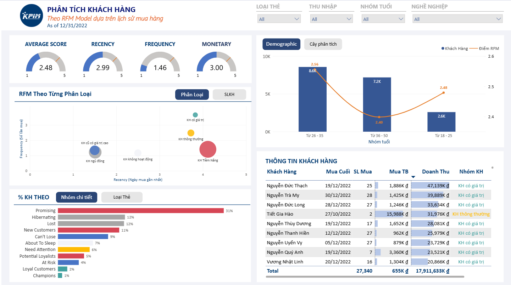
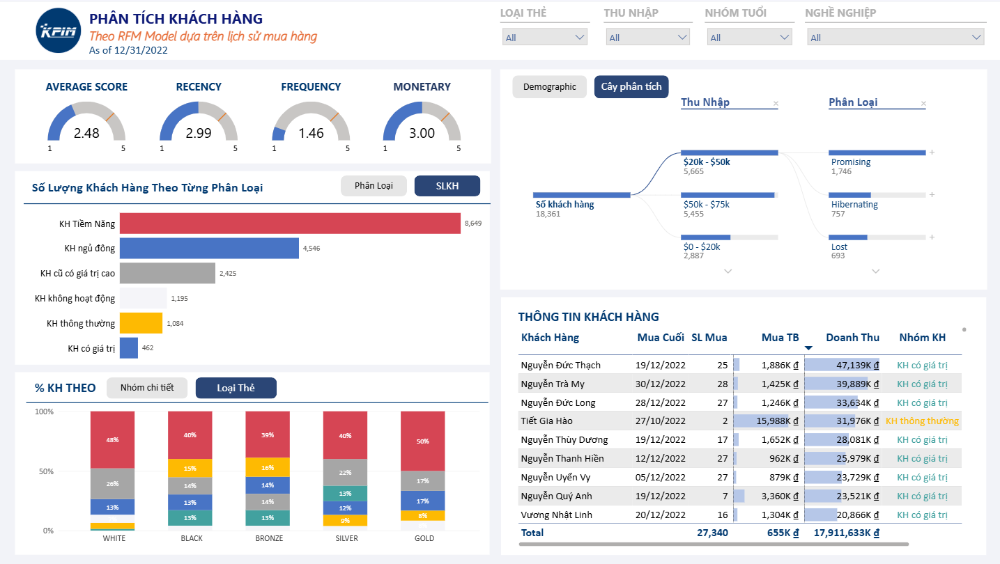

# Phân tích và phân nhóm khách hàng theo mô hình RFM – KPIM Mart

Dự án Power BI chuyển 58.414 dòng giao dịch bán lẻ thành các phân khúc khách hàng có thể hành động: nhóm nào đang tạo giá trị, nhóm nào cần nuôi dưỡng, nhóm nào cần kích hoạt lại và nhóm nào không nên đầu tư chăm sóc tốn kém.



**Công cụ:** Power BI Desktop · Power Query (M) · DAX · SQL Server · Mô hình dạng sao (Star Schema)

---

## 1. Bối cảnh và mục tiêu

KPIM Mart theo dõi doanh thu theo thời gian, số đơn hàng và giá trị hóa đơn, nhưng báo cáo chủ yếu phản ánh doanh số tổng hợp. Bộ phận Chăm sóc khách hàng cần biết:

- Nhóm khách cốt lõi nào đóng góp phần lớn doanh thu và họ mua sắm ra sao?
- Khách nào mới mua gần đây nhưng chưa quay lại, cần được nuôi dưỡng?
- Khách nào từng chi tiêu lớn nhưng đã lâu không mua, cần chiến dịch kích hoạt lại?
- Ngân sách marketing nên phân bổ thế nào để tránh chi phí chăm sóc cao cho khách không còn hoạt động?
- Thu nhập, hạng thẻ, nhóm tuổi, giới tính, học vấn và nghề nghiệp liên hệ ra sao với giá trị mua hàng?

**Mục tiêu:** phân loại khách hàng bằng mô hình R-F-M từ dữ liệu mua hàng, cho biết quy mô và đặc điểm từng nhóm, từ đó đề xuất chương trình khuyến mãi và chăm sóc phù hợp.

> Dữ liệu thuộc bộ dữ liệu thực hành của khóa học Power BI, không phải dữ liệu của doanh nghiệp thật.

## 2. Dữ liệu

| Hạng mục | Giá trị |
| --- | --- |
| Giai đoạn giao dịch | 01/01/2020 – 31/12/2022 |
| Ngày chốt RFM | 31/12/2022 (ngày mua lớn nhất trong dữ liệu) |
| Khách hàng | 18.484, trong đó 18.364 có giao dịch và 120 chưa phát sinh giao dịch |
| Đơn hàng | 27.345 |
| Dòng giao dịch | 58.414 |
| Doanh thu tích lũy | 17.912.095.075 ₫ (khoảng 17,91 tỷ đồng) |
| Cửa hàng / sản phẩm / khuyến mãi | 29 / 353 / 16 |

Nguồn dữ liệu: cơ sở dữ liệu SQL Server `kpim_mart` (giao dịch tại cửa hàng, hồ sơ khách hàng, chương trình khách hàng thân thiết) và một file Excel kế hoạch doanh thu.

## 3. Phương pháp RFM

| Chỉ số | Định nghĩa | Chấm điểm 1–5 |
| --- | --- | --- |
| **Recency (R)** | Số ngày từ lần mua gần nhất đến ngày chốt | Theo ngũ phân vị; mua càng gần đây điểm càng cao |
| **Frequency (F)** | Số đơn hàng riêng biệt của khách | Điểm bằng số đơn, tối đa 5 |
| **Monetary (M)** | Tổng doanh thu phát sinh từ khách | Theo ngũ phân vị; chi tiêu càng nhiều điểm càng cao |

1. Ba điểm được ghép thành mã R-F-M (ví dụ `5-1-3`).
2. Mã được tra trong bảng 125 tổ hợp để xác định một trong **11 phân khúc chi tiết** (Champions, Loyal Customers, Potential Loyalists, New Customers, Promising, Need Attention, About To Sleep, At Risk, Can't Lose, Hibernating, Lost).
3. 11 phân khúc được gộp thành **6 nhóm quản trị**; khách chưa mua hàng được tách riêng.
4. **Average Score** = (R + F + M) / 3, so với mốc mục tiêu 4,0.

Công thức DAX đầy đủ: [docs/dax_measures.md](docs/dax_measures.md).

## 4. Mô hình dữ liệu

Mô hình dạng sao, bảng trung tâm `fact_sales` nối với các bảng chiều `dim_customer`, `dim_product`, `dim_store`, `dim_promotion`, `dim_date`. Hai bảng tính toán `map_rfm_code` (tra cứu 125 tổ hợp) và `dim_rfm_segment` (mô tả và gợi ý hành động từng phân khúc) hỗ trợ phân khúc RFM. Bảng `fact_sales_plan` chứa kế hoạch doanh thu.


Chi tiết từng bảng và cột: [docs/data_dictionary.md](docs/data_dictionary.md).

**Làm sạch dữ liệu trong Power Query:** ghép họ tên, tính tuổi và nhóm tuổi, phân nhóm thu nhập (từ $0–$20k đến Over $100k), mã hóa trình độ học vấn, chuẩn hóa hạng thẻ, bổ sung các cột lịch (thứ, tháng, quý, ngày làm việc).

## 5. Dashboard

Báo cáo gồm hai trang.

**Trang 1 – Phân tích khách hàng** (lọc theo thời gian, hạng thẻ, thu nhập, nhóm tuổi, nghề nghiệp):

1. Bốn gauge Average / Recency / Frequency / Monetary Score trên thang 1–5, kèm vạch mục tiêu 4,0.
2. Phân loại khách hàng theo 6 nhóm (số lượng khách) và theo vị trí Recency/Frequency.
3. Cơ cấu khách hàng theo 11 phân khúc và theo hạng thẻ.
4. Đặc điểm khách hàng: so sánh số khách và điểm RFM theo thu nhập, phân rã theo hạng thẻ, tuổi, giới tính, nghề nghiệp.
5. Bảng chi tiết khách hàng: lần mua cuối, số lần mua, giá trị mua trung bình, doanh thu, nhóm khách.

**Trang 2 – Chi tiết dữ liệu (Drill-through):** từ một khách hàng hoặc một nhóm ở Trang 1, mở lịch sử giao dịch và hóa đơn của đối tượng đã chọn.



## 6. Phát hiện chính

**Sức khỏe RFM toàn hệ thống: Average Score 2,48/5, thấp hơn mục tiêu 4,0.** Recency 2,99, Frequency 1,46, Monetary 3,00. Frequency là điểm yếu rõ nhất: phần lớn khách chỉ mua một hoặc hai lần.

| Nhóm khách hàng | Số khách | % khách | Doanh thu | % doanh thu |
| --- | --- | --- | --- | --- |
| KH Tiềm Năng | 8.650 | 47,1% | 7,67 tỷ ₫ | 42,8% |
| KH cũ có giá trị cao | 2.425 | 13,2% | 5,41 tỷ ₫ | 30,2% |
| KH thông thường | 1.085 | 5,9% | 2,55 tỷ ₫ | 14,2% |
| KH có giá trị | 462 | 2,5% | 2,17 tỷ ₫ | 12,1% |
| KH ngủ đông | 4.547 | 24,8% | 0,07 tỷ ₫ | 0,4% |
| KH không hoạt động | 1.195 | 6,5% | 0,05 tỷ ₫ | 0,3% |

- **KH Tiềm Năng** chiếm gần một nửa số khách và 42,8% doanh thu, mua gần đây (điểm R trung bình khoảng 4,1) nhưng chỉ khoảng 1,41 đơn mỗi khách. Cơ hội lớn nhất là biến lần mua gần đây thành thói quen mua lặp lại.
- **KH cũ có giá trị cao** chỉ chiếm 13,2% số khách nhưng đóng góp 30,2% doanh thu, giá trị khoảng 1,66 triệu ₫ mỗi đơn, nhưng đã lâu không quay lại (R khoảng 1,5). Đây là nhóm cần ưu tiên kích hoạt lại.
- **KH có giá trị** chỉ 2,5% số khách nhưng mua trung bình 4,87 đơn mỗi khách và đóng góp 12,1% doanh thu.
- **KH ngủ đông và KH không hoạt động** gộp lại chiếm 31,3% số khách nhưng chưa đến 1% doanh thu, nên không nên đầu tư chăm sóc cao cấp.
- Phân khúc lớn nhất là **Promising** (30,8% số khách đã mua hàng); **Champions** nhỏ nhất (0,8%).

## 7. Đề xuất hành động

| Nhóm | Hướng hành động |
| --- | --- |
| KH Tiềm Năng | Voucher cho đơn thứ hai, gợi ý mua kèm (cross-sell), combo phù hợp; theo dõi Frequency |
| KH cũ có giá trị cao | Chiến dịch win-back: chăm sóc riêng, ưu đãi cá nhân hóa, quyền lợi theo hạng thẻ |
| KH có giá trị | Duy trì trải nghiệm VIP, quyền lợi và cộng đồng khách hàng thân thiết |
| KH thông thường | Theo dõi biến động Recency và Frequency; thử ưu đãi để nâng giá trị và tần suất |
| KH ngủ đông, KH không hoạt động | Kênh tự động chi phí thấp (SMS, email) để kiểm tra khả năng phản hồi; hạn chế chi phí chăm sóc cao |

## 8. Cấu trúc repository

```
├── README.md
├── LICENSE
├── .gitignore
├── docs/
│   ├── data_dictionary.md   # Mô tả bảng, cột, quan hệ
│   └── dax_measures.md      # Cột tính toán RFM và measure
└── images/                  # Ảnh dashboard
```

File `.pbix` không được đưa lên repository vì chứa dữ liệu đã nạp bên trong; ảnh dashboard và tài liệu trong `docs/` mô tả đầy đủ nội dung dự án.

## 9. Bài học và hạn chế

- Điểm Frequency dùng số đơn (tối đa 5) thay vì phân vị; số đơn trung bình mỗi khách chỉ khoảng 1,5 nên điểm F tập trung ở mức thấp.
- Tuổi và nhóm tuổi tính theo ngày làm mới dữ liệu, không cố định theo ngày chốt RFM.
- Ngưỡng điểm và bảng gán phân khúc là quy ước của dự án, chưa được kiểm định bằng kết quả chiến dịch thực tế.

## 10. Tác giả

**[Họ tên]** – [Vai trò / định hướng nghề nghiệp]
LinkedIn: [đường dẫn] · Email: [địa chỉ email]

